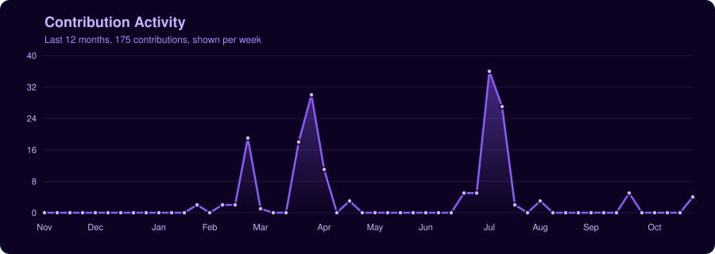

  

<h3 align="center">B.Tech Computer Science and Engineering · Class of 2030</h3>

 

  

---

## 🟣 About Me

 

I'm a first-year Computer Science student who builds AI-integrated web applications independently, end to end: architecture, frontend, API integration, and deployment. My work centres on applied generative AI, wiring LLM APIs into real products rather than treating them as toys, alongside full-stack engineering with React, TypeScript, and modern tooling.

Every project on this profile is solo work, so I own the full stack: design, state management, third-party API orchestration, deployment, and post-launch iteration.

**🎓 Education:** B.Tech Computer Science and Engineering, Lovely Professional University · Class of 2030

**🎯 Open To:** AI/ML internships · Full-stack development roles · Open-source collaboration · Applied GenAI research exposure

---

## 🤖 Tech Stack

**Languages**

**Frontend**

**Backend & Data**

**Cloud, DevOps & Tooling**

---

## 🟣 AI / ML Expertise

| Domain | Proficiency | Details |
|---|:---:|---|
| **LLM API Integration** | ⭐⭐⭐⭐☆ | Groq (Llama 3.1) summarization inside a deployed app, response handling |
| **Prompt Engineering** | ⭐⭐⭐⭐☆ | Structured prompt systems for analysis, tutoring, and content generation |
| **Clustering & Recommendation** | ⭐⭐⭐☆☆ | K-Means genre segmentation, cosine similarity recommender (Spotify dataset) |
| **Local LLM Deployment** | ⭐⭐⭐☆☆ | Ollama served via Gradio for offline academic tutoring |
| **Applied Generative AI Products** | ⭐⭐⭐⭐☆ | End-to-end GenAI features shipped in deployed apps, including JalRakshak |

---

## 📌 Featured Projects

<b>💧 JalRakshak: Water-Stress Awareness Platform for Varanasi</b>

 

AI-grounded water-stress advisory platform built for the 1M1B internship, aligned with SDG 6 (Clean Water) and SDG 13 (Climate Action). Any figure on the site that is not live or sourced is labeled illustrative.

| Category | Detail |
|---|---|
| **Stack** | React, TypeScript, Tailwind CSS, Open-Meteo API, Vercel |
| **Data** | Live weather and air-quality data from Open-Meteo, with no API key required |
| **Scope** | Locality explorer, live environment telemetry, methodology and Responsible AI pages |
| **Impact** | Applies AI to a real local problem with an explicit honesty standard for data provenance |
| **Links** | [Live Site](https://jalrakshak-bice.vercel.app/) · [Repository](https://github.com/Aaradhy-singh/jalrakshak) |

<b>🚀 SpaceShield: No-Backend Space & Defence News Aggregator</b>

 

India-first real-time aggregator pulling from NASA APOD, Spaceflight News, and GNews, with Groq-powered (Llama 3.1 8B Instant) summarization, fully client-side, zero backend infrastructure.

| Category | Detail |
|---|---|
| **Stack** | React, Vite, Tailwind CSS v3, Groq API, NASA APOD API, Spaceflight News API, GNews API |
| **Scale** | Multi-source real-time aggregation, no-backend architecture |
| **Performance** | Client-side fetch and caching, static Vercel edge deployment |
| **Security** | No user accounts and no stored user data |
| **Impact** | India-first framing for space and defence news, an underserved niche |
| **Repository** | [`github.com/Aaradhy-singh/spaceshield`](https://github.com/Aaradhy-singh/spaceshield) |

Architected as a fully static, serverless application to prove that meaningful multi-API aggregation doesn't require backend infrastructure, reducing hosting cost and operational overhead.

<b>📄 ResumeAI Pro: AI-Powered Resume Diagnostic Platform</b>

 

Browser-based resume diagnostic tool analyzing skill gaps, ATS compatibility, impact scoring, and role matching across 300+ roles. No account required, runs entirely client-side.

| Category | Detail |
|---|---|
| **Stack** | React, TypeScript, Vite, Tailwind CSS, shadcn/ui, jsPDF, PostHog, Formspree, Octokit |
| **Scale** | 8 analysis engines, skill gap matching against 300+ roles |
| **Performance** | Fully client-side analysis pipeline, PDF export via jsPDF |
| **Security** | No account required, no server-side data storage |
| **Impact** | End-to-end resume-to-hire pipeline: scoring, GitHub analysis, LinkedIn share, feedback loop via PostHog (6 custom events) |
| **Links** | [Live Site](https://resume-ai-pro-psi.vercel.app/) · [Repository](https://github.com/Aaradhy-singh/resume-ai-pro) |

Built with a strict monochrome design system (black/white/navy, DM Serif Display + DM Mono, zero border-radius) to force disciplined UI decisions rather than defaulting to templated component libraries.

<b>🎓 Local AI Academic Tutor</b>

 

Offline-capable AI chatbot running a local LLM through Ollama, served via a Gradio interface, no external API dependency, no data leaving the device.

| Category | Detail |
|---|---|
| **Stack** | Python, Gradio, Ollama |
| **Scale** | Single-user local inference |
| **Performance** | Fully offline, latency bound by local hardware |
| **Security** | No external API calls, no data transmission |
| **Impact** | Privacy-preserving academic support tool with zero recurring API cost |
| **Repository** | [`github.com/Aaradhy-singh/local-llm-academic-tutor`](https://github.com/Aaradhy-singh/local-llm-academic-tutor) |

Chosen specifically to explore local inference tradeoffs versus cloud LLM APIs: cost, latency, and privacy in a single constrained project.

<b>✨ Gesture Particle Universe: Real-Time 3D Gesture-Controlled Particle System</b>

 

A single-file, 9,000-particle interactive 3D system controlled entirely via hand gestures, combining computer vision with custom shader rendering.

| Category | Detail |
|---|---|
| **Stack** | Three.js, MediaPipe, custom GLSL shaders, single-file HTML |
| **Scale** | 9,000 real-time rendered particles |
| **Performance** | Custom GLSL shaders for GPU-accelerated particle rendering |
| **Security** | Client-only, no data collection |
| **Impact** | Demonstrates real-time CV and WebGL integration in a zero-dependency deployable file |
| **Repository** | [`github.com/Aaradhy-singh/gesture-particle-universe`](https://github.com/Aaradhy-singh/gesture-particle-universe) |

Deployed as a single HTML file, a deliberate constraint to prove the entire CV and shader pipeline could ship without a build step.

---

## 💼 Experience

<table>
<tr>
<td width="80" align="center"></td>
<td>
<b>1M1B (1 Million for 1 Billion)</b> 
Internship · 4 mos 
Remote
</td>
</tr>
<tr>
<td align="center">●</td>
<td>

**Green Skills & Applied AI Intern** &nbsp; <kbd>Present</kbd> 
Oct 2026 - Present · 1 mo · in partnership with Govt. of Uttar Pradesh, Microsoft, and MeitY Startup Hub

A 70+ hour program applying AI to climate and sustainability problems across four phases: Foundations, Analysis, Application, and Impact.

- Live sessions and weekly assessments on sustainability fundamentals and applied AI
- Climate action case study work: root-cause mapping, SDG alignment, indicators, and stakeholder analysis
- AI-enabled solution design: problem context, AI use case, inputs and outputs, and workflow
- Building a final AI and sustainability project as the program capstone

📎 **Certificate of Bootcamp Completion**

</td>
</tr>
<tr>
<td align="center">●</td>
<td>

**AI for Sustainability Intern** 
Jul 2026 - Sep 2026 · 3 mos

During the AI for Sustainability internship, I worked on sustainability-focused AI projects, exploring real-world problem statements and applying prompt engineering, Agentic AI, RAG, IBM Granite models, and introductory quantum computing concepts.

- Explored IBM AI tools and labs through guided hands-on workshops
- Used design thinking to develop sustainability-oriented AI solutions
- Designed and deployed **JalRakshak**, a water-stress awareness platform for Varanasi, as the final project

📎 **IBM Certificate** &nbsp;·&nbsp; 🔗 [JalRakshak live site](https://jalrakshak-bice.vercel.app/)

💎 **Artificial Intelligence (AI) · Retrieval-Augmented Generation (RAG) · +5 skills**

</td>
</tr>
</table>

---

## 🎖️ Achievements

| Recognition | Details |
|---|---|
| Independent Shipping | 5 projects built and shipped solo across full-stack, GenAI, and computer vision |
| Certification Portfolio | Certifications across Oracle, Anthropic, AWS, Google, Microsoft, IBM, Hugging Face, JPMorgan Chase |
| Letter of Recommendation | From Corizo Edutech, recognizing performance in AI/ML training, Python, data analysis, and project execution |

---

## 📜 Certifications & Skills

### Certifications

| Certificate | Skills gained |
|---|---|
| **Oracle Cloud Infrastructure 2025 Certified AI Foundations Associate** | Artificial Intelligence · Generative AI · Machine Learning (Basics) · OCI · Cloud Computing |
| **AWS Cloud Practitioner Essentials** | Amazon Web Services (AWS) · Cloud Computing |
| **Fundamentals of Machine Learning and Artificial Intelligence** | Artificial Intelligence · Machine Learning (Basics) · Amazon Web Services (AWS) |
| **Introduction to Artificial Intelligence** | Artificial Intelligence · Generative AI · Machine Learning (Basics) |
| **Introduction to Generative AI and Agents** | Artificial Intelligence · Generative AI |
| **Prompt Design in Vertex AI** | Artificial Intelligence · Generative AI · Prompt Engineering · Vertex AI |
| **Foundations of Prompt Engineering** | Generative AI · Prompt Engineering · Amazon Web Services (AWS) · Cloud Computing |
| **Prompt Engineering: Shaping Better AI Responses** | Generative AI · Prompt Engineering |
| **Introduction to Prompt Engineering with GitHub Copilot** | Prompt Engineering · GitHub Copilot |
| **AI Fluency: Framework & Foundations** | Generative AI · Prompt Engineering · Large Language Models (LLM) |
| **The LLM Course** | Large Language Models (LLM) |
| **EAB GenAI for Proposal Generation Job Simulation** | Generative AI · Prompt Engineering |
| **Corizo AI Training and Internship Certificates** | Artificial Intelligence · Generative AI · LLM · NLP · RAG · Machine Learning (Basics) · Deep Learning · Python |
| **Corizo Machine Learning Training and Internship Certificates** | Machine Learning (Basics) · NumPy · Pandas · Python |

### Built Through Projects and Internship

| Project | Skills applied |
|---|---|
| **1M1B AI for Sustainability Internship** | Artificial Intelligence · Prompt Engineering · Agentic AI Development · RAG · AI for Sustainability and SDG-aligned solution design · IBM SkillsBuild and IBM Granite models · Design Thinking |
| **JalRakshak** | SDG-aligned solution design · React.js · TypeScript · Tailwind CSS · Three.js |
| **ResumeAI Pro** | JavaScript · TypeScript · React.js · Vite · REST APIs · GitHub API · jsPDF · PostHog · Resume Analysis |
| **SpaceShield** | Large Language Models (LLM) · REST APIs · GitHub · Vercel V0 |
| **Local AI Academic Tutor** | Prompt Engineering · Local LLM Deployment · Python · Gradio · Ollama |
| **Gesture Particle Universe** | Generative AI · AI-Assisted Development · Web Deployment · Version Control · Product Development |

**Also:** OpenGL Shading Language (GLSL) · Software Engineering · Oracle Cloud

---

## 📈 GitHub Analytics

  

---

## 📊 Contribution Activity

---

## 🐍 Contribution Snake

---

## 🎯 Current Focus

| 📚 Learning | 🔨 Building | 🔭 Exploring |
|:---:|:---:|:---:|
| Prompt engineering and LLM orchestration | Deployable AI products, solo | Agentic workflows |
| System design fundamentals | AI for sustainability | Local LLM inference |

---

## 🟣 Connect

---

*"Ship the deployed artifact, not the tutorial."*

Last updated: October 2026

