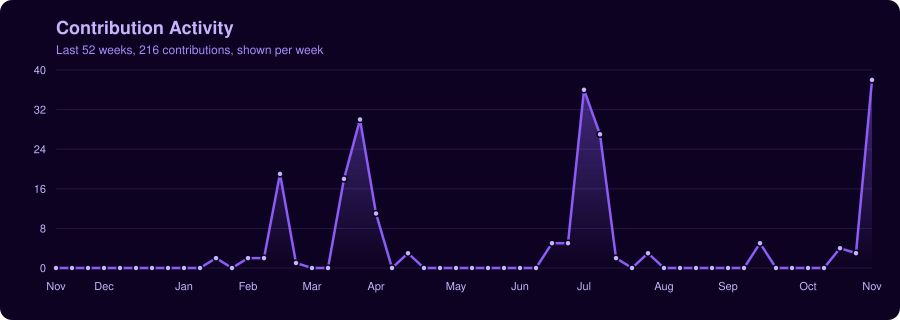

  

<h3 align="center">B.Tech Computer Science and Engineering · Class of 2030</h3>

 

  

---

## 🟣 About Me

 

I'm a first-year Computer Science student building full-stack and AI-integrated web applications. My current work focuses on practical API integrations, user-facing interfaces, and deploying projects with modern web tools.

**🎓 Education:** B.Tech Computer Science and Engineering, Lovely Professional University · Class of 2030

**🎯 Open To:** AI/ML internships · Full-stack development roles · Open-source collaboration · Applied GenAI research exposure

---

## 🤖 Tech Stack

**Languages**

**Frontend**

**Backend & Data**

**Cloud, DevOps & Tooling**

---

## 🟣 Applied AI / ML Work

- Groq-powered article summaries in SpaceShield
- Resume feedback using rule-based analysis in ResumeAI Pro
- A local academic tutor that connects to Ollama
- JalRakshak presents live weather and air-quality observations alongside clearly labeled reference information

---

## 📌 Featured Projects

| Project | Overview | Stack | Highlights |
|---|---|---|---|
| **💧 JalRakshak** [Live](https://jalrakshak-bice.vercel.app/) · [Repo](https://github.com/Aaradhy-singh/jalrakshak) | Civic water-awareness platform for Varanasi, with live weather and air-quality observations plus clearly labeled reference information | React · TypeScript · Tailwind CSS · Open-Meteo API · Vercel | Live weather and air-quality observations, locality explorer, methodology and Responsible AI pages, and clearly labeled static reference data |
| **🚀 SpaceShield** [Repo](https://github.com/Aaradhy-singh/spaceshield) | Space and defence news dashboard with selected API feeds and Groq-powered article summaries | React · Vite · Tailwind CSS · Groq · NASA APOD · Spaceflight News · GNews | Selected news and space feeds with AI-generated article summaries |
| **📄 ResumeAI Pro** [Live](https://resume-ai-pro-psi.vercel.app/) · [Repo](https://github.com/Aaradhy-singh/resume-ai-pro) | Browser-based resume analysis tool with skill-gap feedback, ATS keyword checks, impact feedback, and PDF export | React · TypeScript · Vite · Tailwind CSS · shadcn/ui · jsPDF · PostHog | Rule-based analysis, role comparisons, PDF export, no account required |
| **🎓 Local AI Academic Tutor** [Repo](https://github.com/Aaradhy-singh/local-llm-academic-tutor) | Local academic tutor using Ollama through its OpenAI-compatible API | Python · Ollama | Runs against a local Ollama service without an external model API |
| **✨ Gesture Particle Universe** [Repo](https://github.com/Aaradhy-singh/gesture-particle-universe) | Interactive 3D particle system controlled by hand gestures | Three.js · MediaPipe · GLSL | Three.js and MediaPipe Hands, shipped as a single HTML file with no build step |

---

## 💼 Experience

<table>
<tr>
<td width="80" align="center"></td>
<td>
<b>1M1B (1 Million for 1 Billion)</b> 
Internship · 4 mos 
Remote
</td>
</tr>
<tr>
<td align="center">●</td>
<td>

**Green Skills & Applied AI Intern** &nbsp; <kbd>Present</kbd> 
Oct 2026 - Present · Remote

A 70+ hour program focused on applying AI to climate and sustainability problems across four phases: Foundations, Analysis, Application, and Impact.

- Live sessions and weekly assessments on sustainability fundamentals and applied AI
- Climate action case study work: root-cause mapping, SDG alignment, indicators, and stakeholder analysis
- AI-enabled solution design: problem context, AI use case, inputs and outputs, and workflow
- Building a final AI and sustainability project as the program capstone

📎 **Certificate of Bootcamp Completion**

</td>
</tr>
<tr>
<td align="center">●</td>
<td>

**AI for Sustainability Intern** 
Jul 2026 - Sep 2026 · 3 mos

The AI for Sustainability internship covered sustainability-focused problem statements, prompt engineering, Agentic AI, RAG, IBM Granite models, and introductory quantum computing concepts.

- Explored IBM AI tools and labs through guided hands-on workshops
- Used design thinking to develop sustainability-oriented AI solutions
- Designed and deployed **JalRakshak**, a water-stress awareness platform for Varanasi, as the final project

📎 **IBM Certificate** &nbsp;·&nbsp; 🔗 [JalRakshak live site](https://jalrakshak-bice.vercel.app/)

💎 **Artificial Intelligence (AI) · Retrieval-Augmented Generation (RAG) · +5 skills**

</td>
</tr>
</table>

---

## 🎖️ Achievements

| Achievement | Details |
|---|---|
| 🚀 **Projects** | Selected work includes web applications, local AI tools, and interactive graphics |
| 💼 **Internships** | 1M1B AI for Sustainability (Jul 2026 - Sep 2026) and Green Skills & Applied AI for Climate Action (Oct 2026 - Present) |
| 📜 **Certifications** | AWS, Oracle, Google, Microsoft, IBM, Hugging Face, Anthropic, JPMorgan Chase |
| ✉️ **Letter of Recommendation** | From Corizo Edutech, recognizing performance in AI/ML training, Python, data analysis, and project execution |

---

## 📜 Certifications & Skills

| Certification | Skills |
|---|---|
|  | Cloud Computing · AWS · Machine Learning Basics · Prompt Engineering |
|  | AI Foundations · OCI · Cloud Computing · Generative AI |
|  | Vertex AI · Prompt Engineering · Generative AI |
|  | GitHub Copilot · Prompt Engineering |
|  | IBM SkillsBuild · Granite Models · RAG · Agentic AI |
|  | Large Language Models (LLM) |
|  | Generative AI · Prompt Engineering · LLM |

---

## 📈 GitHub Analytics

  

---

## 📊 Contribution Activity

---

## 🐍 Contribution Snake

---

## 🎯 Current Focus

| 📚 Learning | 🔨 Building | 🔭 Exploring |
|:---:|:---:|:---:|
| Prompt engineering and LLM orchestration | Deployable AI products, solo | Agentic workflows |
| System design fundamentals | AI for sustainability | Local LLM inference |

---

## 🟣 Connect

---

*"Ship the deployed artifact, not the tutorial."*

Last updated: October 2026

