

  

<h3 align="center">B.Tech Computer Science and Engineering (CSE Core) · Class of 2030</h3>

 

  

---

## 🟣 About Me

 

I'm Aaradhy, a first-year B.Tech Computer Science and Engineering (CSE Core) student at Lovely Professional University, graduating in 2030. I enjoy building software that solves practical problems and makes complex information easier to use.

Through my projects, I’ve worked on React and TypeScript interfaces, API integrations, browser-based tools, local services, and deployment. Recent examples include JalRakshak, a water-awareness platform for Varanasi; SpaceShield, a space and defence news dashboard; and ResumeAI Pro, a browser-based resume analysis tool. These projects reflect my broader software engineering interests alongside my CSE Core studies.

I’m strengthening my programming and computer science fundamentals while building useful, polished projects. I value clear interfaces, reliable behavior, and descriptions that match what a project actually does.

**🎓 Education:** B.Tech Computer Science and Engineering (CSE Core), Lovely Professional University · Class of 2030

**🎯 Open To:** Software engineering internships · Full-stack development roles · Open-source collaboration

---

## 💻 Tech Stack

**Languages**

<table border="1" bordercolor="#3D4656" cellpadding="9" cellspacing="0"><tr><td align="center" width="140">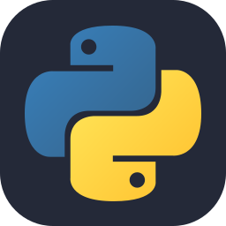 Python</td><td align="center" width="140"> HTML</td><td align="center" width="140">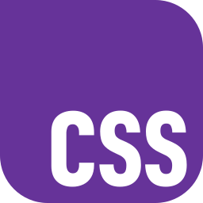 CSS</td><td align="center" width="140">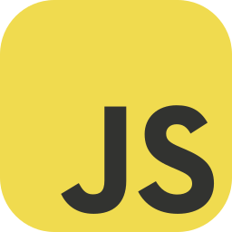 JavaScript</td></tr></table>

**Frontend**

<table border="1" bordercolor="#3D4656" cellpadding="9" cellspacing="0"><tr><td align="center" width="140"> HTML</td><td align="center" width="140"> CSS</td><td align="center" width="140">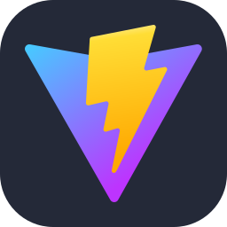 Vite</td></tr></table>

**Backend**

<table border="1" bordercolor="#3D4656" cellpadding="9" cellspacing="0"><tr><td align="center" width="140"> Python</td><td align="center" width="140"> FastAPI</td></tr></table>

**Cloud & Version Control**

<table border="1" bordercolor="#3D4656" cellpadding="9" cellspacing="0"><tr><td align="center" width="140">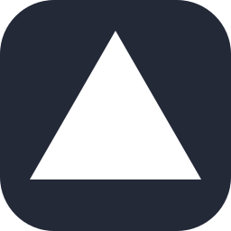 Vercel</td><td align="center" width="140"> GitHub</td><td align="center" width="140">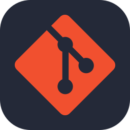 Git</td></tr></table>

**Tools & AI Assistants**

<table border="1" bordercolor="#3D4656" cellpadding="9" cellspacing="0">
<tr>
<td align="center" width="140"> Visual Studio Code</td>
<td align="center" width="140">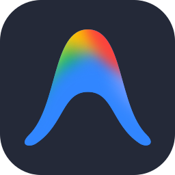 Antigravity</td>
<td align="center" width="140">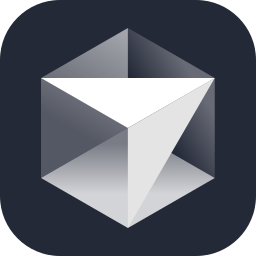 Cursor</td>
<td align="center" width="140"> GitHub Copilot</td>
</tr>
<tr>
<td align="center" width="140">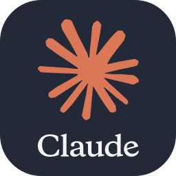 Claude</td>
<td align="center" width="140">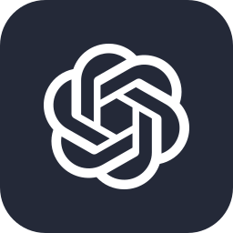 ChatGPT</td>
<td align="center" width="140"> Codex</td>
<td align="center" width="140"> Gemini</td>
</tr>
</table>

---

## 🟣 Engineering in Practice

- API-backed article summaries in SpaceShield
- Browser-based resume feedback in ResumeAI Pro
- Local model integration in an academic tutor using Ollama
- Live weather and air-quality observations in JalRakshak, alongside clearly labeled reference information

---

## 📌 Featured Projects

<table border="1" bordercolor="#8B5CF6" cellpadding="10" cellspacing="0">
<thead>
<tr>
<th>Project</th><th>Overview</th><th>Stack</th><th>Highlights</th>
</tr>
</thead>
<tbody>
<tr>
<td><b>💧 JalRakshak</b> <a href="https://jalrakshak-bice.vercel.app/">Live</a> · <a href="https://github.com/Aaradhy-singh/jalrakshak">Repo</a></td>
<td>Civic water-awareness platform for Varanasi, with live weather and air-quality observations plus clearly labeled reference information</td>
<td>React · TypeScript · Tailwind CSS · Open-Meteo API · Vercel</td>
<td>Live weather and air-quality observations, locality explorer, methodology and Responsible AI pages, and clearly labeled static reference data</td>
</tr>
<tr>
<td><b>🚀 SpaceShield</b> <a href="https://github.com/Aaradhy-singh/spaceshield">Repo</a></td>
<td>Space and defence news dashboard with selected API feeds and Groq-powered article summaries</td>
<td>React · Vite · Tailwind CSS · Groq · NASA APOD · Spaceflight News · GNews</td>
<td>Selected news and space feeds with AI-generated article summaries</td>
</tr>
<tr>
<td><b>📄 ResumeAI Pro</b> <a href="https://resume-ai-pro-psi.vercel.app/">Live</a> · <a href="https://github.com/Aaradhy-singh/resume-ai-pro">Repo</a></td>
<td>Browser-based resume analysis tool with skill-gap feedback, ATS keyword checks, impact feedback, and PDF export</td>
<td>React · TypeScript · Vite · Tailwind CSS · shadcn/ui · jsPDF · PostHog</td>
<td>Rule-based analysis, role comparisons, PDF export, no account required</td>
</tr>
<tr>
<td><b>🎓 Local AI Academic Tutor</b> <a href="https://github.com/Aaradhy-singh/local-llm-academic-tutor">Repo</a></td>
<td>Local academic tutor using Ollama through its OpenAI-compatible API</td>
<td>Python · Ollama</td>
<td>Runs against a local Ollama service without an external model API</td>
</tr>
<tr>
<td><b>✨ Gesture Particle Universe</b> <a href="https://github.com/Aaradhy-singh/gesture-particle-universe">Repo</a></td>
<td>Interactive 3D particle system controlled by hand gestures</td>
<td>Three.js · MediaPipe · GLSL</td>
<td>Three.js and MediaPipe Hands, shipped as a single HTML file with no build step</td>
</tr>
</tbody>
</table>

---

## 💼 Experience

<table>
<tr>
<td colspan="2" bgcolor="#17132B"><b>✦ EXPERIENCE TIMELINE</b> &nbsp; · &nbsp;  <b>1M1B (1 Million for 1 Billion)</b> · Remote</td>
</tr>
<tr>
<td width="76" align="center" valign="top"><b>01</b> NOW</td>
<td>
<b>Green Skills & Applied AI Intern</b> &nbsp; <kbd>Present</kbd> 
Oct 2026 - Present · Remote  
A 70+ hour program focused on applying AI to climate and sustainability problems across four phases: Foundations, Analysis, Application, and Impact.
<ul>
<li>Live sessions and weekly assessments on sustainability fundamentals and applied AI</li>
<li>Climate action case study work: root-cause mapping, SDG alignment, indicators, and stakeholder analysis</li>
<li>AI-enabled solution design: problem context, AI use case, inputs and outputs, and workflow</li>
<li>Building a final AI and sustainability project as the program capstone</li>
</ul>
📎 <b>Certificate of Bootcamp Completion</b>
</td>
</tr>
<tr>
<td align="center" valign="top"><b>02</b> 2026</td>
<td>
<b>AI for Sustainability Intern</b> 
Jul 2026 - Sep 2026 · 3 mos  
The internship covered sustainability-focused problem statements, prompt engineering, Agentic AI, RAG, IBM Granite models, and introductory quantum computing concepts.
<ul>
<li>Explored IBM AI tools and labs through guided hands-on workshops</li>
<li>Used design thinking to develop sustainability-oriented AI solutions</li>
<li>Designed and deployed <b>JalRakshak</b>, a water-stress awareness platform for Varanasi, as the final project</li>
</ul>
📎 <b>IBM Certificate</b> &nbsp;·&nbsp; 🔗 <a href="https://jalrakshak-bice.vercel.app/">JalRakshak live site</a>  
💎 <b>Artificial Intelligence (AI) · Retrieval-Augmented Generation (RAG) · +5 skills</b>
</td>
</tr>
</table>

---

## 🎖️ Achievements

| Achievement | Details |
|---|---|
| 🚀 **Projects** | Selected work includes web applications, local AI tools, and interactive graphics |
| 💼 **Internships** | 1M1B AI for Sustainability (Jul 2026 - Sep 2026) and Green Skills & Applied AI for Climate Action (Oct 2026 - Present) |
| 📜 **Certifications** | AWS, Oracle, Google, Microsoft, IBM, Hugging Face, Anthropic, JPMorgan Chase |
| ✉️ **Letter of Recommendation** | From Corizo Edutech, recognizing performance in technical training, Python, data analysis, and project execution |

---

## 📜 Certifications & Skills

| Certification | Skills |
|---|---|
|  | Cloud Computing · AWS · Machine Learning Basics · Prompt Engineering |
|  | AI Foundations · OCI · Cloud Computing · Generative AI |
|  | Vertex AI · Prompt Engineering · Generative AI |
|  | GitHub Copilot · Prompt Engineering |
|  | IBM SkillsBuild · Granite Models · RAG · Agentic AI |
|  | Large Language Models (LLM) |
|  | Generative AI · Prompt Engineering · LLM |

---

## 📈 GitHub Analytics

  

---

## 📊 Public Repository Stats

  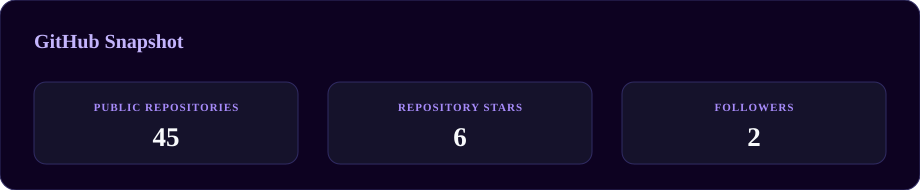

---

## 💻 Languages in Public Repositories

  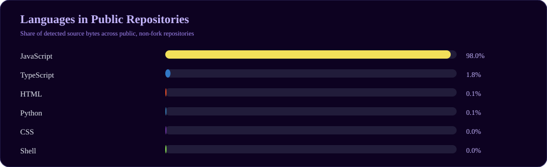

---

## 📊 Contribution Activity

---

## 🐍 Contribution Snake

---

## 🎯 Current Focus

| 📚 Learning | 🔨 Building | 🔭 Exploring |
|:---:|:---:|:---:|
| Data structures and algorithms | Full-stack web applications | Human-computer interaction |
| Software design fundamentals | API-backed project features | Cloud deployment |

---

## 🟣 Connect

---

*"Ship the deployed artifact, not the tutorial."*

Last updated: November 2026

